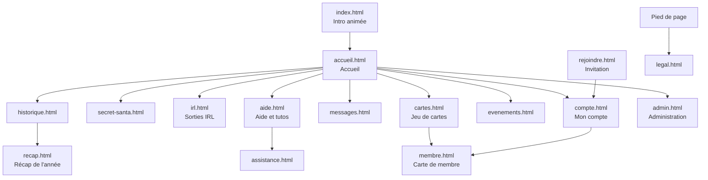

# Plan du site — Humane Gang

Toutes les pages, qui peut les voir, ce qu'elles contiennent et comment on y arrive.
Version : branche `nuit`, 22 octobre 2026.

## Vue d'ensemble

- **Menu principal** (en-tête) : Accueil, Secret Santa, IRL, Historique, Messages, Cartes. Les entrées affichées, leur ordre et leurs libellés se règlent dans Administration › Membres › Accès aux pages.
- **Outils de l'en-tête** : recherche, « ? » (Aide et tutos), mode sans limite (admin), préférences d'affichage, Mon compte, déconnexion, et le lien Admin ou Staff si on y a droit.
- **Pied de page** : Événements, Mentions légales, Confidentialité, Cookies (liens réglables dans Administration › Site › Réglages).

## Pages

Accès : **Public** = sans compte ; **Membre** = connecté ; **Staff** = membre avec au moins une permission ; **Admin** = administrateur. L'admin peut aussi masquer une page à certains membres (Accès aux pages).

| Page | Accès | Contenu principal | Script |
| --- | --- | --- | --- |
| `index.html` | Public | Intro 3D au défilement, rejouée une fois par jour ; redirige ensuite vers l'accueil | `intro.js`, `intro-redirect.js` |
| `rejoindre.html` | Public | Ouverture d'un lien d'invitation : donne un code et mène à l'inscription | `rejoindre.js` |
| `compte.html` | Public (connexion) puis Membre | Connexion, inscription, mot de passe oublié ; profil, avatar, infos personnelles, notifications Discord et push, badges, export et suppression des données | `compte.js` |
| `accueil.html` | Membre | Fil d'activité, défis du gang, quêtes de la semaine, raccourcis Secret Santa / IRL / Historique | `accueil.js` |
| `secret-santa.html` | Membre | Édition en cours : inscription, avancement, ma cible et sa liste, ma liste de souhaits, mon envoi, messages secrets, inscrits | `secret-santa.js` |
| `irl.html` | Membre | Prochaine sortie, dates à caler (sondages), à venir, sorties passées, statistiques, carte des lieux, toutes nos rencontres | `irl.js`, `irl-history.js` |
| `historique.html` | Membre | Frise des années, éditions passées du Secret Santa, albums photo, moments cultes et réactions | `historique.js` |
| `recap.html` | Membre | Récap de l'année du membre et du gang | `recap.js` |
| `messages.html` | Membre | Conversations privées, nouveau message, messages avec son Santa (anonymes) | `messages.js` |
| `cartes.html` | Membre | Onglets Boosters, Collection, Classement, Échanges ; collection d'un autre membre en lecture seule (`#collection/<id>`) ; drops à attraper | `cartes.js` et `cartes-*.js` |
| `membre.html` | Membre | Carte de membre d'un joueur : infos partagées, badges, vitrine de cartes, « Voir sa collection » | `membre.js` |
| `evenements.html` | Membre | Événements en cours et passés (images à attraper), classement des chasseurs | `evenements.js` |
| `aide.html` | Public | 61 tutos en 6 groupes, recherche, accès à l'assistance | `aide.js`, `tutos/` |
| `assistance.html` | Public | Formulaire d'aide (bug, question, idée) et suivi de mes demandes | `assistance.js` |
| `legal.html` | Public | Mentions légales, confidentialité, cookies | `legal.js` |
| `offline.html` | Public | Page affichée hors connexion | — |
| `admin.html` | Staff / Admin | Panel d'administration (détail ci-dessous) | `admin.js`, `admin/`, `admin-*` |
| `affiches/` | Public | Affiches A3 imprimables : badges, Paillettes, cartes, boosters | — |

## Administration (`admin.html`)

Adresse d'une section : `admin.html#domaine/sous-section`. Chaque sous-section demande une permission Staff (entre crochets).

| Domaine | Sous-sections |
| --- | --- |
| Pilotage | Vue d'ensemble · Journal [journal] · Staff (admin seulement) |
| Membres | Comptes : actifs, Staff, fantômes [membres] · Invitations [membres] · Accès aux pages [membres] |
| Vie du gang | Sorties IRL [evenements] · Souvenirs et photos [souvenirs] · Secret Santa [secret_santa] · Événements [themes] · Badges [badges] |
| Jeu de cartes | Séries · Cartes · Quêtes · Économie · Joueurs · Statistiques · Échanges · Drops · Défis du gang [cartes] |
| Communication | Assistance [support] · Boîte à idées [support] · Messagerie [messages] · Bot Discord [bot] |
| Site | Réglages [reglages] · Thème [themes] |

## Ce qui tourne en arrière-plan

| Tâche | Quand | Rôle |
| --- | --- | --- |
| `hg-cron-5min` | Toutes les 5 minutes | Rappels de sorties et du Secret Santa, début et fin des événements |
| `hg-badges-hourly` | Toutes les heures | Attribution des badges |
| `hg-cards-hourly` | Toutes les heures | Récompenses de présence du jeu de cartes |
| `hg-challenges-hourly` | Toutes les heures | Progression et récompenses des défis du gang |
| `hg-birthdays-daily` | 8 h, heure suisse | Messages et annonces d'anniversaire |

Fonctions edge (bot Discord) : `hg-notify` (notifications du site), `hg-support` (assistance), `hg-birthdays`, `hg-cron`, `hg-push` (notification push à chaque nouveau message), `hg-album` (téléchargement d'un album en ZIP).
