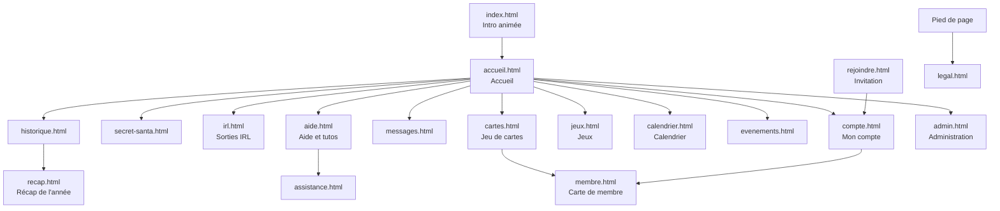

# Plan du site — Humane Gang

Toutes les pages, qui peut les voir, ce qu'elles contiennent, où est leur code et comment on y arrive.
Version : état du code au 27 octobre 2026, après le rangement du dépôt (pages dans `site/pages/`, code dans `site/assets/espaces/`).

Les adresses sont celles du site publié : `/pages/<catégorie>/<nom>.html`. Le plan du dépôt (où est quel fichier, où ranger un nouveau fichier) est dans [PLAN-DU-DEPOT.md](PLAN-DU-DEPOT.md).

## Vue d'ensemble

## Barre de menus

La barre comporte cinq entrées : « Le jeu de cartes », « IRL », « Jeux », « Calendrier » et « Autres ». « Le jeu de cartes » et « IRL » ouvrent un menu déroulant. « Jeux » et « Calendrier » sont des liens directs. « Autres » est rempli automatiquement. Un lien n'apparaît que si le membre a accès à sa page, et un menu vide disparaît. Sur téléphone (760 px et moins), un bouton « Menu » déplie les menus en accordéon.

| Menu | Entrées (adresse) |
| --- | --- |
| Le jeu de cartes | Ouverture (`/pages/cartes/cartes.html#ouverture`), Inventaire (`#inventaire`), Boutique (`#boutique`), Mes cartes (`#collection`), Classement (`#classement`), Échanges (`#echanges`), Arène (`#arene`) |
| IRL | Secret Santa (`/pages/irl/secret-santa.html`), IRL (`/pages/irl/irl.html`), Historique (`/pages/irl/historique.html`) |
| Jeux | Lien direct vers `/pages/jeux/jeux.html`. Les jeux sont rangés en onglets dans cette page (voir plus bas). |
| Calendrier | Lien direct vers `/pages/irl/calendrier.html` |
| Autres | Pages du menu (réglage `in_nav` de la base) accessibles et non rangées ailleurs, dans l'ordre de la base. Libellés courts : Annuaire (`membre.html`), Récap de l'année (`recap.html`). |

Les libellés se règlent dans Administration › Site › Menu et pied de page ; les pages accessibles dans Administration › Membres › Accès aux pages.

Raccourcis clavier : « g » puis une lettre (aller à une page), « / » (recherche), « ? » (aide-mémoire des raccourcis), Ctrl ou Cmd + K (recherche).

## Menu en arc (photo de profil)

La photo de profil, à droite de la barre, ouvre un quart de cercle d'icônes. Rangée proche de la photo : Messages, Recherche, Mon compte. Rangée extérieure : Aide et tutos, Affichage (préférences d'affichage), Sans limite (mode sans limite, administrateur seulement), Admin ou Staff (si on y a droit), Déconnexion.

Vue « comme un membre » (voir ADMIN-PANEL.md) : Admin, Staff et Sans limite sont masqués.

## Pages

Accès : **Public** = sans compte ; **Membre** = connecté ; **Staff** = membre avec au moins une permission ; **Admin** = administrateur. L'administrateur peut aussi masquer une page à certains membres (Membres › Accès aux pages) ou la donner par rôle (Membres › Rôles). « Selon Accès aux pages » : l'accès se règle dans le panel.

Les chemins de code sont relatifs à `site/assets/espaces/` (« espace » = un dossier, voir PLAN-DU-DEPOT.md). Un espace peut servir plusieurs pages.

### Pages d'accueil, compte et aide

| Page (adresse) | Accès | Contenu principal | Code (espaces/…) |
| --- | --- | --- | --- |
| `/index.html` | Public | Intro 3D au défilement, rejouée une fois par jour ; redirige ensuite vers l'accueil | `accueil/intro.js`, `intro-redirect.js`, `intro-logo.js` |
| `/pages/infos/rejoindre.html` | Public | Ouverture d'un lien d'invitation : donne un code et mène à l'inscription | `infos/rejoindre.js` |
| `/pages/compte/compte.html` | Public (connexion) puis Membre | Connexion, inscription, mot de passe oublié ; profil, avatar, infos personnelles, notifications Discord et push, badges, export et suppression des données | `compte/compte.js` |
| `/pages/compte/accueil.html` | Membre | Fil d'activité, défis du gang, question du jour, quêtes de la semaine, raccourcis Secret Santa / IRL / Historique | `accueil/accueil.js`, `accueil/intro-daily.js` |
| `/pages/compte/membre.html` | Membre | Carte de membre d'un joueur : infos partagées, badges, vitrine de cartes, « Voir sa collection » | `compte/membre.js` |
| `/pages/compte/messages.html` | Membre | Conversations privées, nouveau message, messages avec son Santa (anonymes) | `messages/messages.js`, `messages-groupes.js` |
| `/pages/infos/aide.html` | Public | Tutos illustrés en groupes, recherche, accès à l'assistance | `infos/aide.js`, `infos/tutos/` |
| `/pages/infos/assistance.html` | Public | Formulaire d'aide (bug, question, idée) et suivi de mes demandes | `infos/assistance.js` |
| `/pages/infos/legal.html` | Public | Mentions légales, confidentialité, cookies | `infos/legal.js` |

### IRL, événements et jeux du gang

| Page (adresse) | Accès | Contenu principal | Code (espaces/…) |
| --- | --- | --- | --- |
| `/pages/irl/secret-santa.html` | Membre | Édition en cours : inscription, avancement, ma cible et sa liste, ma liste de souhaits, mon envoi, messages secrets, inscrits | `irl/secret-santa.js`, `irl/ss-pairs.js`, `irl/ss-card.js`, `irl/ss-unwrap.js` |
| `/pages/irl/irl.html` | Membre | Prochaine sortie, dates à caler (sondages), à venir, sorties passées, statistiques, carte des lieux, toutes nos rencontres | `irl/irl.js`, `irl/irl-history.js`, `irl/irl-carte.js` |
| `/pages/irl/historique.html` | Membre | Frise des années, éditions passées du Secret Santa, albums photo, moments cultes et réactions | `irl/historique.js`, `irl/irl-history.js` |
| `/pages/irl/recap.html` | Membre | Récap de l'année du membre et du gang | `irl/recap.js` |
| `/pages/irl/calendrier.html` | Membre | Vue mois des rendez-vous : sorties IRL, séances du ciné-club, rendez-vous récurrents des groupes, anniversaires (jour et mois), dates du site ; filtres ; export d'un rendez-vous ; abonnement personnel (adresse ICS, régénérable) | `irl/calendrier.js`, `irl/ics.js` |
| `/pages/irl/cine.html` | Membre | Ciné-club : vote de la séance (2 à 4 films), « Je serai là », lien du salon vocal | `irl/cine.js` |
| `/pages/irl/playlist.html` | Selon Accès aux pages | Playlist du gang : partage d'un morceau (YouTube, Spotify, Deezer, SoundCloud), vote pour le morceau de la semaine, réactions | `irl/playlist.js`, `irl/contenus.css` |
| `/pages/irl/citations.html` | Selon Accès aux pages | Mur des citations (contenu de la rubrique « Qui a dit ça ? ») | `irl/citations.js` |
| `/pages/irl/evenements.html` | Membre | Événements en cours et passés (images à attraper), classement des chasseurs ; les événements à venir ne sont pas montrés | `irl/evenements.js` |
| `/pages/jeux/secret.html` | Public (hors menu) | Le carnet des secrets : secrets trouvés et leur date, les autres comptés sans être nommés | `arcade/secret.js` |

### Jeu de cartes

| Page (adresse) | Accès | Contenu principal | Code (espaces/…) |
| --- | --- | --- | --- |
| `/pages/cartes/cartes.html` | Membre | Onglets Ouverture, Inventaire, Boutique, Mes cartes, Classement, Échanges, Arène (`#arene`) ; collection d'un autre membre en lecture seule (`#collection/<id>`) | `cartes/cartes.js` et `cartes/cartes-*.js` |
| `/pages/cartes/collection-a4.html` | Membre | Planche A4 imprimable d'une collection (progression, grille de cartes possédées et manquantes), à imprimer ou enregistrer en PDF | `cartes/collection-a4.js` |

### Jeux (page Jeux et jeux indépendants)

| Page (adresse) | Accès | Contenu principal | Code (espaces/…) |
| --- | --- | --- | --- |
| `/pages/jeux/jeux.html` | Membre (selon Accès aux pages) | Onglet « Missions quotidiennes » (`#aujourdhui`, programme du jour et Paillettes gagnées), puis un onglet par jeu (liste des anchors plus bas). La vue « Tous les jeux » range les cartes en sections : Jeux quotidiens (une partie par jour), Jeux flash (à volonté), Jeux multijoueurs, Jeux spéciaux | `jeux/jeux.js`, `jeux/onglets.js`, `jeux/<id>.js` |
| `/pages/jeux/quiz.html` | Selon Accès aux pages | Questions du gang : réponses (une tentative par question), explication après réponse, Paillettes gagnées, historique | `quiz/quiz.js` |
| `/pages/jeux/duels.html` | Membre (à confirmer) | Duels entre deux membres : bataille, dames, échecs, morpion, Puissance 4, Othello, Mastermind, pierre-feuille-ciseaux, Qui est-ce ? | `duels/duels.js`, `duels/vues/` |
| `/pages/jeux/uno.html` | Membre (à confirmer) | Uno en ligne, 2 à 20 joueurs ; lien d'invitation `?code=` ou `#rejoindre/<code>` | `uno/uno.js`, `uno/vues/` |
| `/pages/jeux/loup-garou.html` | Membre (à confirmer) | Loup-Garou multijoueur : salle, rôles, meneur, révélation, statistiques | `loup-garou/loup-garou.js`, `loup-garou/vues/` |
| `/pages/jeux/nom-de-code.html` | Membre (à confirmer) | Codenames (Nom de code) en équipes : salle, plateau, fin de partie, statistiques (`#stats`) ; lien `?code=` ou `#rejoindre/<code>` | `nom-de-code/nom-de-code.js`, `nom-de-code/vues/` |
| `/pages/jeux/blackjack.html`, `catan.html`, `cluedo.html`, `destins.html`, `monopoly.html`, `pictionary.html`, `poker.html`, `risk.html`, `shadow-hunters.html` | Membre (à confirmer) | Un jeu de plateau ou de cartes par page, partie en ligne entre membres (salle, table, fin de partie) | `plateaux/plateaux.js`, `plateaux/<jeu>.css`, `plateaux/jeux/<jeu>/`, `plateaux/vues/` |
| `/pages/jeux/simulateur.html` | Hors navigation | Simulateur de téléphone, outil de test. Non publié selon docs/PUBLICATION.md. | `jeux/simulateur.js` |

### Pages système et affiches

| Page (adresse) | Accès | Contenu principal | Code (espaces/…) |
| --- | --- | --- | --- |
| `/pages/admin/admin.html` | Staff / Admin | Panel d'administration (détail dans ADMIN-PANEL.md) | `admin/admin.js`, `admin/admin-*.js`, `admin/admin-*.css` |
| `/404.html` | Public | Redirige les anciennes adresses vers les nouvelles ; sinon page introuvable, avec les mini-jeux de l'Arcade (Paillettes, Raclette, Domu-mobile) | `arcade/jeu404.js`, `arcade/eggs.css` |
| `/offline.html` | Public | Page affichée hors connexion | `commun/offline.css` |
| `/affiches/` (`site/affiches/`) | Public | Affiches A3 imprimables : badges, Paillettes, cartes, boosters, gamme | `affiches/affiches.js`, `affiches/gamme.js` |

Le code du panel est dans `site/assets/espaces/admin/` (coquille : `shell.js`, `router.js`).

## Adresses avec ancre (`#…`)

Une ancre choisit l'onglet ou la vue à l'ouverture. Elle ne charge pas une autre page.

**Cartes** (`/pages/cartes/cartes.html`) : `#ouverture`, `#inventaire`, `#boutique`, `#collection`, `#classement`, `#echanges`, `#arene`, `#collection/<id>` (collection d'un autre membre, lecture seule).

**Jeux** (`/pages/jeux/jeux.html`) : `#aujourdhui` (missions quotidiennes), puis un onglet par jeu. Les onglets du tableau ci-dessous sont des jeux quotidiens (une partie par jour), sauf les jeux flash (jouables à volonté) : l’Arcade (`#arcade-…`), le Démineur et le 2048. Une seule partie par jour est récompensée pour l’Arcade, tous jeux confondus. Le détail des sections est dans `site/assets/espaces/jeux/catalogue.js` :

| Ancre | Jeu | Ancre | Jeu |
| --- | --- | --- | --- |
| `#geo` | GeoGuessr | `#carte-mystere` | Carte mystère |
| `#citations` | Qui a dit ça ? | `#jeu-video` | Jeu vidéo du jour |
| `#jour` | Question du jour | `#pochette` | Pochette du jour |
| `#sutom` | Sutom HG | `#replique` | Réplique du jour |
| `#framed` | Framed | `#pays` | Pays du jour |
| `#heardle` | Heardle | `#plat` | Plat du jour |
| `#arcade` | Arcade (`#arcade-paillettes`, `#arcade-raclette`, `#arcade-domu`) | `#connexions` | Connexions |
| | | `#mots-croises` | Mots croisés |
| | | `#mot-mele` | Mot mêlé |
| | | `#anagramme` | Anagramme |
| | | `#nerdle` | Nerdle du gang |
| | | `#demineur` | Démineur (compétition) |
| | | `#sudoku` | Sudoku du jour |

La liste des onglets vit dans `site/assets/espaces/jeux/onglets.js` : c'est elle qui fait foi si la page change.

**Accueil intro** : l'intro d'index.html est rejouée une fois par jour.

**Pronostics** : l'adresse de la page des pronostics de saison est réglable dans Administration › Saisons (par défaut `/pages/jeux/jeux.html#pronos`).

## Administration (`admin.html`)

Six domaines, avec leurs sous-sections (détail, permissions et adresses : ADMIN-PANEL.md). Chaque sous-section demande une permission Staff, sauf mention « administrateur ».

| Domaine | Sous-sections |
| --- | --- |
| Pilotage | Vue d'ensemble · Planning · Journal · Staff (administrateur) · Bot (Bot Discord, Commandes slash) · Site (Identité et mentions légales, Textes et intro, Menu et pied de page, État du site, Erreurs du site, Archives, Clés avancées) · Apparence (Thème) · Assistance (Assistance, Boîte à idées, Messagerie, Fil d'activité) |
| Membres | Comptes (Comptes, Rôles, À relancer, Invitations, Champs du profil, Vie sociale, Accueil des membres) · Entraide (Parrainage, Compétences) · Accès aux pages (Pages, Matrice membres × pages) · Badges (Catalogue, Attribution, Critères automatiques) |
| IRL | Membres IRL · Sorties IRL · Souvenirs et photos · Secret Santa |
| Event | Événements à thème · Calendrier et cinéma · Calendrier de l'Avent · Saison des Worlds · Anniversaire du gang |
| Le jeu de cartes | Gestion globale · Catalogue (Séries, Cartes, Boosters) · Économie (Paillettes et dons, Tirage, Recyclage et fabrication, Limites) · Animation (Quêtes, Défis du gang, Drops, Cagnotte et bulletin, Cartes Champions, Codes cadeaux, Atelier, Enchères) · Suivi (Joueurs, Échanges, Statistiques) · Arène |
| Autres jeux | Questions du gang · Sutom du gang · GeoGuessr · Citations « Qui a dit ça ? » · Preuves de quêtes · Framed et Heardle · Arcade (pages 404) · Secrets · Mes jeux |

## Anciennes adresses

Avant le rangement, les pages étaient toutes à la racine du site (`/jeux.html`, `/accueil.html`…). Les nouvelles adresses sont sous `/pages/<catégorie>/`. Correspondance :

| Ancienne adresse | Nouvelle adresse |
| --- | --- |
| `/index.html` | `/index.html` (inchangée) |
| `/404.html` | `/404.html` (inchangée) |
| `/offline.html` | `/offline.html` (inchangée) |
| `/accueil.html` | `/pages/compte/accueil.html` |
| `/admin.html` | `/pages/admin/admin.html` |
| `/aide.html` | `/pages/infos/aide.html` |
| `/assistance.html` | `/pages/infos/assistance.html` |
| `/legal.html` | `/pages/infos/legal.html` |
| `/rejoindre.html` | `/pages/infos/rejoindre.html` |
| `/compte.html` | `/pages/compte/compte.html` |
| `/membre.html` | `/pages/compte/membre.html` |
| `/messages.html` | `/pages/compte/messages.html` |
| `/cartes.html` | `/pages/cartes/cartes.html` |
| `/collection-a4.html` | `/pages/cartes/collection-a4.html` |
| `/calendrier.html` | `/pages/irl/calendrier.html` |
| `/cine.html` | `/pages/irl/cine.html` |
| `/citations.html` | `/pages/irl/citations.html` |
| `/evenements.html` | `/pages/irl/evenements.html` |
| `/historique.html` | `/pages/irl/historique.html` |
| `/irl.html` | `/pages/irl/irl.html` |
| `/playlist.html` | `/pages/irl/playlist.html` |
| `/recap.html` | `/pages/irl/recap.html` |
| `/secret-santa.html` | `/pages/irl/secret-santa.html` |
| `/jeux.html` | `/pages/jeux/jeux.html` |
| `/quiz.html` | `/pages/jeux/quiz.html` |
| `/duels.html` | `/pages/jeux/duels.html` |
| `/uno.html` | `/pages/jeux/uno.html` |
| `/loup-garou.html` | `/pages/jeux/loup-garou.html` |
| `/nom-de-code.html` | `/pages/jeux/nom-de-code.html` |
| `/secret.html` | `/pages/jeux/secret.html` |
| `/simulateur.html` | `/pages/jeux/simulateur.html` |
| `/blackjack.html`, `/catan.html`, `/cluedo.html`, `/destins.html`, `/monopoly.html`, `/pictionary.html`, `/poker.html`, `/risk.html`, `/shadow-hunters.html` | `/pages/jeux/<même nom>.html` |

**Redirection automatique.** GitHub Pages sert `site/404.html` pour toute adresse inconnue. Son tout premier script lit le nom de page demandé : si c'est une page connue (`/jeux.html`, ou un lien parti dans la mauvaise catégorie comme `/pages/compte/duels.html`), il renvoie aussitôt vers la bonne adresse (`/pages/jeux/jeux.html`, `/pages/jeux/duels.html`) en gardant `?…` et `#…`. Les anciens liens (Discord, notifications, favoris, appli installée) continuent donc de marcher. Une page ajoutée au site doit aussi être ajoutée à sa table, en haut de `site/404.html`, et à `PAGE_DIR` dans `site/assets/commun/core/pages-access.js`.

## Ce qui tourne en arrière-plan

| Tâche | Quand | Rôle |
| --- | --- | --- |
| `hg-cron-5min` | Toutes les 5 minutes | Rappels de sorties et du Secret Santa, début et fin des événements, question du jour (9 h, réglable) |
| `hg-auctions-close` | Toutes les 5 minutes | Clôture des enchères du jeu de cartes |
| `hg-badges-hourly` | Toutes les heures (à hh:07) | Attribution des badges |
| `hg-cards-hourly` | Toutes les heures (à hh:23) | Récompenses de présence du jeu de cartes |
| `hg-challenges-hourly` | Toutes les heures (à hh:17) | Progression et récompenses des défis du gang |
| `hg-quests-hourly` | Toutes les heures (à hh:02) | Progression des quêtes |
| `hg-event-cards-hourly` | Toutes les heures (à hh:41) | Distribution des cartes d'événement |
| `hg-birthdays-daily` | 8 h, heure suisse | Messages et annonces d'anniversaire |

Fonctions edge (code dans `supabase/functions/<nom>/`) : `hg-notify` (notifications du site), `hg-support` (assistance), `hg-birthdays`, `hg-cron`, `hg-push` (notification push à chaque nouveau message), `hg-album` (téléchargement d'un album en ZIP), `hg-archive` (archive annuelle en ZIP, administrateur), `hg-calendar` (flux ICS du calendrier), `hg-discord` (commandes slash du bot), `hg-nj-images` (images des jeux `nj-*`).
