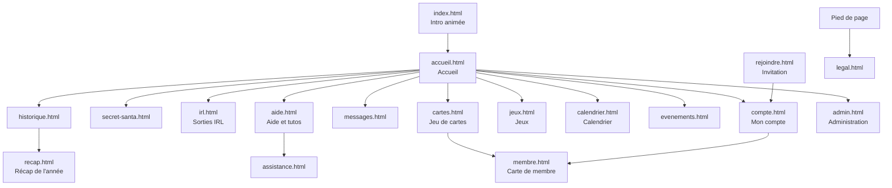

# Plan du site — Humane Gang

Toutes les pages, qui peut les voir, ce qu'elles contiennent et comment on y arrive.
Version : état du code au 24 octobre 2026.

## Vue d'ensemble

## Barre de menus

La barre comporte cinq entrées : « Le jeu de cartes », « IRL », « Jeux », « Calendrier » et « Autres ». Les trois premières, et « Autres », ouvrent un menu déroulant. Un lien n'apparaît que si le membre a accès à sa page, et un menu vide disparaît. Sur téléphone (760 px et moins), un bouton « Menu » déplie les menus en accordéon.

| Menu | Entrées (adresse) |
| --- | --- |
| Le jeu de cartes | Ouverture (`cartes.html#ouverture`), Inventaire (`#inventaire`), Boutique (`#boutique`), Mes cartes (`#collection`), Classement (`#classement`), Échanges (`#echanges`), Arène (`#arene`) |
| IRL | Secret Santa (`secret-santa.html`), IRL (`irl.html`), Historique (`historique.html`) |
| Jeux | Les missions du jour (`jeux.html#aujourdhui`) ; séparateur ; GeoGuessr (`#geo`), Qui a dit ça ? (`#citations`), Question du jour (`#jour`), Sutom HG (`#sutom`), Framed (`#framed`), Heardle (`#heardle`) ; sous-menu **Arcade** : Paillettes (`#arcade-paillettes`), Raclette (`#arcade-raclette`), Domu-mobile (`#arcade-domu`) |
| Calendrier | Lien direct vers `calendrier.html` |
| Autres | Pages du menu (réglage `in_nav` de la base) accessibles et non rangées ailleurs, dans l'ordre de la base. Libellés courts : Annuaire (`membre.html`), Récap de l'année (`recap.html`). |

Les libellés se règlent dans Administration › Site › Menu et pied de page ; les pages accessibles dans Administration › Membres › Accès aux pages.

Raccourcis clavier : « g » puis une lettre (aller à une page), « / » (recherche), « ? » (aide-mémoire des raccourcis), Ctrl ou Cmd + K (recherche).

## Menu en arc (photo de profil)

La photo de profil, à droite de la barre, ouvre un quart de cercle d'icônes. Rangée proche de la photo : Messages, Recherche, Mon compte. Rangée extérieure : Aide et tutos, Affichage (préférences d'affichage), Sans limite (mode sans limite, administrateur seulement), Admin ou Staff (si on y a droit), Déconnexion.

Vue « comme un membre » (voir ADMIN-PANEL.md) : Admin, Staff et Sans limite sont masqués.

## Pages

Accès : **Public** = sans compte ; **Membre** = connecté ; **Staff** = membre avec au moins une permission ; **Admin** = administrateur. L'administrateur peut aussi masquer une page à certains membres (Membres › Accès aux pages) ou la donner par rôle (Membres › Rôles). « Selon Accès aux pages » : l'accès se règle dans le panel.

| Page | Accès | Contenu principal | Script |
| --- | --- | --- | --- |
| `index.html` | Public | Intro 3D au défilement, rejouée une fois par jour ; redirige ensuite vers l'accueil | `intro.js`, `intro-redirect.js` |
| `rejoindre.html` | Public | Ouverture d'un lien d'invitation : donne un code et mène à l'inscription | `rejoindre.js` |
| `compte.html` | Public (connexion) puis Membre | Connexion, inscription, mot de passe oublié ; profil, avatar, infos personnelles, notifications Discord et push, badges, export et suppression des données | `compte.js` |
| `accueil.html` | Membre | Fil d'activité, défis du gang, question du jour, quêtes de la semaine, raccourcis Secret Santa / IRL / Historique | `accueil.js` |
| `secret-santa.html` | Membre | Édition en cours : inscription, avancement, ma cible et sa liste, ma liste de souhaits, mon envoi, messages secrets, inscrits | `secret-santa.js` |
| `irl.html` | Membre | Prochaine sortie, dates à caler (sondages), à venir, sorties passées, statistiques, carte des lieux, toutes nos rencontres | `irl.js`, `irl-history.js` |
| `historique.html` | Membre | Frise des années, éditions passées du Secret Santa, albums photo, moments cultes et réactions | `historique.js` |
| `recap.html` | Membre | Récap de l'année du membre et du gang | `recap.js` |
| `messages.html` | Membre | Conversations privées, nouveau message, messages avec son Santa (anonymes) | `messages.js` |
| `cartes.html` | Membre | Onglets Ouverture, Inventaire, Boutique, Mes cartes, Classement, Échanges, Arène (`#arene`) ; collection d'un autre membre en lecture seule (`#collection/<id>`) | `cartes.js` et `cartes-*.js` |
| `jeux.html` | Membre (selon Accès aux pages) | Onglet « Les missions du jour » (`#aujourdhui`, programme du jour et Paillettes gagnées), puis un onglet par jeu : `#geo`, `#citations`, `#jour`, `#sutom`, `#framed`, `#heardle`, `#arcade` (choix `#arcade-paillettes`, `#arcade-raclette`, `#arcade-domu`) | `jeux.js`, `jeux/onglets.js`, `jeux/<id>.js` |
| `calendrier.html` | Membre | Vue mois des rendez-vous : sorties IRL, séances du ciné-club, rendez-vous récurrents des groupes, anniversaires (jour et mois), dates du site ; filtres ; export d'un rendez-vous ; abonnement personnel (adresse ICS, régénérable) | `calendrier.js`, `ics.js` |
| `cine.html` | Membre | Ciné-club : vote de la séance (2 à 4 films), « Je serai là », lien du salon vocal | `cine.js` |
| `playlist.html` | Selon Accès aux pages | Playlist du gang : partage d'un morceau (YouTube, Spotify, Deezer, SoundCloud), vote pour le morceau de la semaine, réactions | `playlist.js` |
| `quiz.html` | Selon Accès aux pages | Questions du gang : réponses (une tentative par question), explication après réponse, Paillettes gagnées, historique | `quiz.js` |
| `membre.html` | Membre | Carte de membre d'un joueur : infos partagées, badges, vitrine de cartes, « Voir sa collection » | `membre.js` |
| `collection-a4.html` | Membre | Planche A4 imprimable d'une collection (progression, grille de cartes possédées et manquantes), à imprimer ou enregistrer en PDF | `collection-a4.js` |
| `evenements.html` | Membre | Événements en cours et passés (images à attraper), classement des chasseurs ; les événements à venir ne sont pas montrés | `evenements.js` |
| `aide.html` | Public | Tutos illustrés en groupes, recherche, accès à l'assistance | `aide.js`, `tutos/` |
| `assistance.html` | Public | Formulaire d'aide (bug, question, idée) et suivi de mes demandes | `assistance.js` |
| `legal.html` | Public | Mentions légales, confidentialité, cookies | `legal.js` |
| `secret.html` | Public (hors menu) | Le carnet des secrets : secrets trouvés et leur date, les autres comptés sans être nommés | `secret.js` |
| `404.html` | Public | Page introuvable, avec les mini-jeux de l'Arcade (Paillettes, Raclette, Domu-mobile) | `404.js`, `arcade` |
| `simulateur.html` | Hors navigation | Simulateur de téléphone, outil de test | `simulateur.js` |
| `offline.html` | Public | Page affichée hors connexion | — |
| `admin.html` | Staff / Admin | Panel d'administration (détail dans ADMIN-PANEL.md) | `admin.js`, `admin/`, `admin-*` |
| `affiches/` | Public | Affiches A3 imprimables : badges, Paillettes, cartes, boosters | — |

## Administration (`admin.html`)

Six domaines, avec leurs sous-sections (détail, permissions et adresses : ADMIN-PANEL.md). Chaque sous-section demande une permission Staff, sauf mention « administrateur ».

| Domaine | Sous-sections |
| --- | --- |
| Pilotage | Vue d'ensemble · Planning · Journal · Staff (administrateur) · Bot (Bot Discord, Commandes slash) · Site (Identité et mentions légales, Textes et intro, Menu et pied de page, État du site, Erreurs du site, Archives, Clés avancées) · Apparence (Thème) · Assistance (Assistance, Boîte à idées, Messagerie, Fil d'activité) |
| Membres | Comptes (Comptes, Rôles, À relancer, Invitations, Champs du profil, Vie sociale, Accueil des membres) · Entraide (Parrainage, Compétences) · Accès aux pages (Pages, Matrice membres × pages) · Badges (Catalogue, Attribution, Critères automatiques) |
| IRL | Membres IRL · Sorties IRL · Souvenirs et photos · Secret Santa |
| Event | Événements à thème · Calendrier et cinéma · Calendrier de l'Avent · Saison des Worlds · Anniversaire du gang |
| Le jeu de cartes | Gestion globale · Catalogue (Séries, Cartes, Boosters) · Économie (Paillettes et dons, Tirage, Recyclage et fabrication, Limites) · Animation (Quêtes, Défis du gang, Drops, Cagnotte et bulletin, Cartes Champions, Codes cadeaux, Atelier, Enchères) · Suivi (Joueurs, Échanges, Statistiques) · Arène |
| Autres jeux | Questions du gang · Sutom du gang · GeoGuessr · Citations « Qui a dit ça ? » · Preuves de quêtes · Framed et Heardle · Arcade (pages 404) · Secrets · Mes jeux |

## Ce qui tourne en arrière-plan

| Tâche | Quand | Rôle |
| --- | --- | --- |
| `hg-cron-5min` | Toutes les 5 minutes | Rappels de sorties et du Secret Santa, début et fin des événements, question du jour (9 h, réglable) |
| `hg-auctions-close` | Toutes les 5 minutes | Clôture des enchères du jeu de cartes |
| `hg-badges-hourly` | Toutes les heures (à hh:07) | Attribution des badges |
| `hg-cards-hourly` | Toutes les heures (à hh:23) | Récompenses de présence du jeu de cartes |
| `hg-challenges-hourly` | Toutes les heures (à hh:17) | Progression et récompenses des défis du gang |
| `hg-quests-hourly` | Toutes les heures (à hh:02) | Progression des quêtes |
| `hg-event-cards-hourly` | Toutes les heures (à hh:41) | Distribution des cartes d'événement |
| `hg-birthdays-daily` | 8 h, heure suisse | Messages et annonces d'anniversaire |

Fonctions edge : `hg-notify` (notifications du site), `hg-support` (assistance), `hg-birthdays`, `hg-cron`, `hg-push` (notification push à chaque nouveau message), `hg-album` (téléchargement d'un album en ZIP), `hg-archive` (archive annuelle en ZIP, administrateur), `hg-calendar` (flux ICS du calendrier), `hg-discord` (commandes slash du bot).
